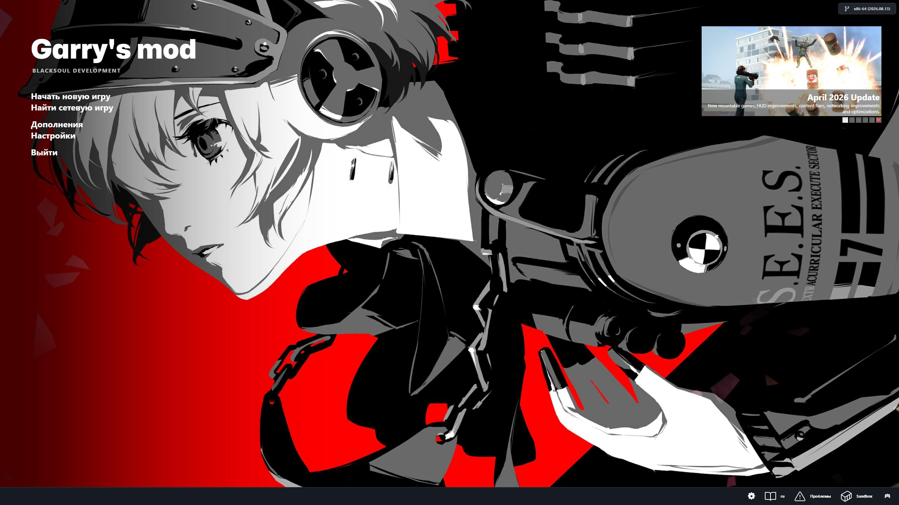

# BlackSoul Gmod Theme

A dark, GitHub-style theme for Garry's Mod: main menu, server browser, addon manager, map selection and the Derma spawn menu — restyled as a single drop-in addon. Based on [JWalkerMailly/Derma-Github-Theme](https://github.com/JWalkerMailly/Derma-Github-Theme).

## Features

- Dark GitHub-style palette across the whole menu UI
- Menu files load from the addon folder — game updates and Steam file verification don't wipe the theme
- Server browser synced with the current in-game browser: infinite scroll, double-click to join, country flags, version tags, favorites by IP
- Addon manager with preset import/export, multi-select enable/disable and dependency warnings
- Settings gear in the navbar: UI scale (75–135%) and an optional "apply theme to all gamemodes"

## Installation

1. Close Garry's Mod.
2. Copy this folder into `.../Steam/steamapps/common/GarrysMod/garrysmod/addons/`
3. Start the game.

If you previously installed a version by copying files into `garrysmod/html`, run Steam's "Verify integrity of game files" once to restore the originals — the addon overrides them anyway.

## Usage

Open the gear icon in the bottom-right of the main menu:

- **UI Scale** — minus / current value (click to reset) / plus, 75–135%.
- **Apply theme to all gamemodes** — off by default; Takes effect on the next game load.

Both settings persist between sessions.

## Credits

- Base project: [JWalkerMailly/Derma-Github-Theme](https://github.com/JWalkerMailly/Derma-Github-Theme)
- Menu icons: [Octicons](https://primer.style/foundations/icons) by GitHub
